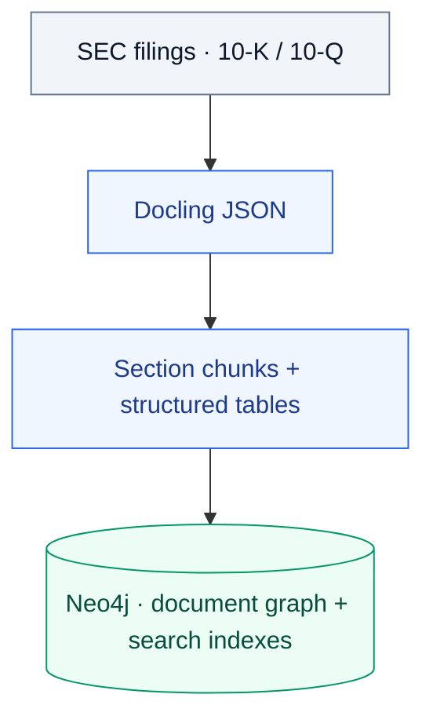
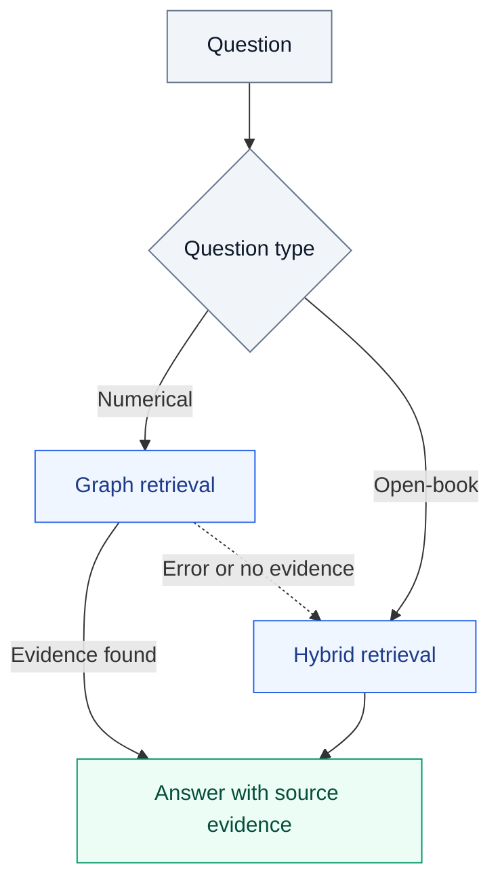

# Financial Document GraphRAG

Question answering over SEC 10-K and 10-Q filings, with FinanceBench for evaluation.
The pipeline combines document retrieval with structured financial tables so
answers can be traced to their source pages, reporting periods, and units.

Built with **Docling · Neo4j · LangGraph · FastAPI · Ollama / Azure OpenAI**.

## How it works

**1. Build the document index**



**2. Retrieve evidence and answer**

Both retrieval paths query the Neo4j index built above.



- **Structured ingestion:** retains reading order, table spans, page coordinates,
  and supported caption and footnote links in JSON.
- **Financial evidence:** connects filings, sections, chunks, tables, and cells;
  preserves metric names, reporting periods, values, and units.
- **Question routing:** open-book questions use vector and full-text retrieval.
  Numerical questions use graph retrieval, with hybrid fallback on errors or
  when all graph branches return no evidence.

API and batch queries share the same LangGraph workflow. `RETRIEVER_MODE=auto`
enables this routing; numerical queries do not run hybrid search unless fallback
is needed.

## Get started

You need **Python 3.13**, **uv**, **Neo4j or Aura**, and an **Ollama** server for
local generation and embeddings. Azure OpenAI is available for cloud generation.

**1. Install dependencies.**

```bash
git clone https://github.com/Penelope-Liang/Finance_Document_GraphRAG.git
cd Finance_Document_GraphRAG
uv sync --python 3.13 --extra app --extra ollama --extra openai
```

**2. Configure the environment.** Create `.env` from [.env.example](.env.example)
if it does not already exist. Set your Neo4j connection and model settings:

| Setting | Purpose |
| --- | --- |
| `NEO4J_URI`, `NEO4J_USER`, `NEO4J_PASSWORD`, `NEO4J_DATABASE` | Database connection |
| `OLLAMA_HOST`, `OLLAMA_LLM_MODEL`, `OLLAMA_EMBED_MODEL` | Running Ollama server and installed models |
| `APP_PROFILE=local`, `LLM_BACKEND=ollama`, `RETRIEVER_MODE=auto` | Local query routing |

**3. Ingest your filings.** Follow [PDF ingestion](docs/ingestion.md) to parse
PDFs, import the document graph, and build the vector/full-text indexes. Querying
requires these data and indexes; starting the API does not create them.

**4. Start the API.**

```bash
uv run --env-file .env --extra app --extra ollama --extra openai \
  python scripts/run_api.py
```

Open [the API docs](http://localhost:8000/docs) to send a `/query` request.
Responses include the answer, retrieved evidence, and source metadata.
`/health` reports service health without checking database or model connectivity.

## Documentation

- [PDF ingestion](docs/ingestion.md) — parsing, graph import, embeddings, and JSON replay.
- [Batch queries and evaluation](docs/usage.md) — retrieval options and FinanceBench evaluation.
- [Azure deployment](docs/azure_container_apps.md) — cloud configuration and deployment.
- [Troubleshooting](docs/runbook.md) — connection, configuration, and runtime issues.

## License

Built on the Neo4j GraphRAG Python package. See [LICENSE.txt](LICENSE.txt) and
[NOTICE.txt](NOTICE.txt) for licensing and attribution.
